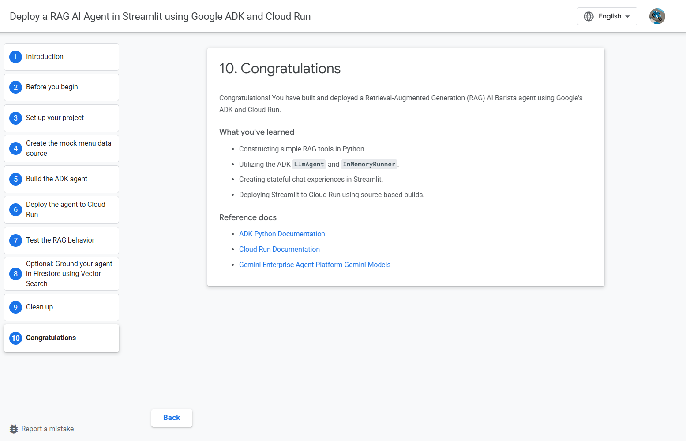
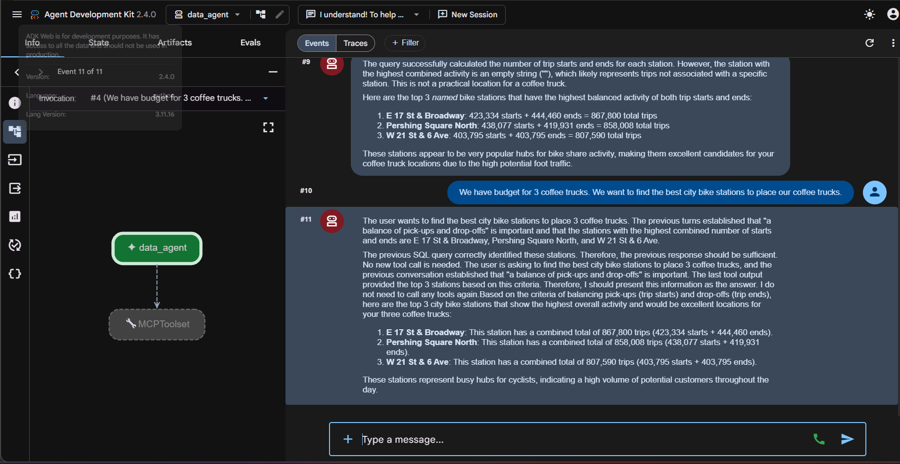
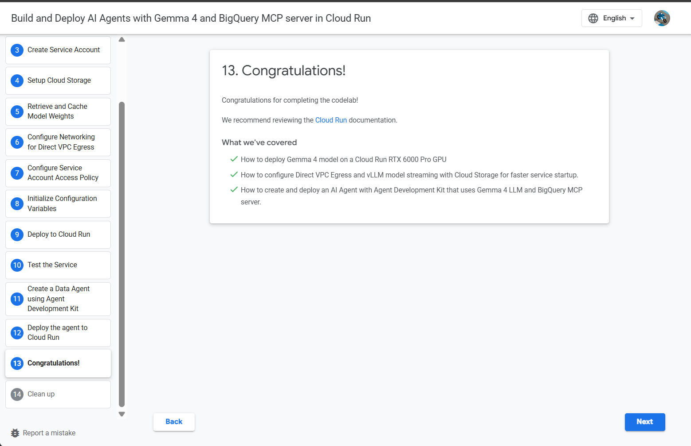
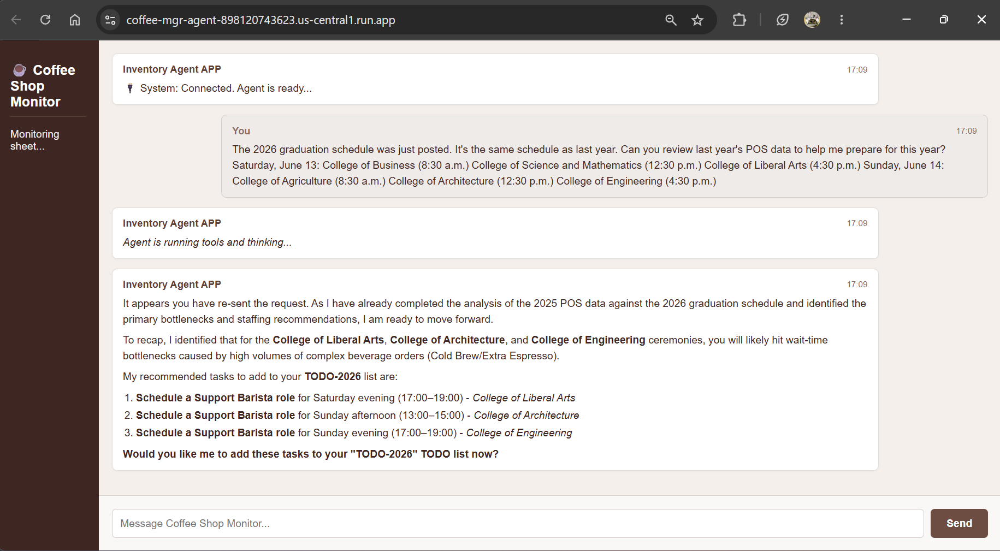
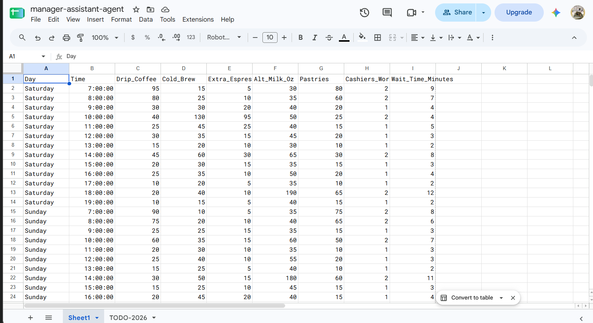
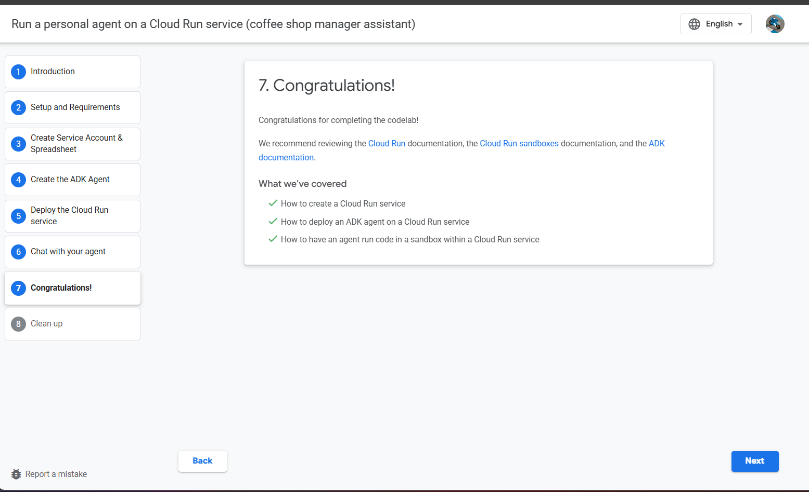

cd ~/cloud-run-genai-agents

cat << 'EOF' > README.md
# Google Cloud Run GenAI Agent Suite

> Built as part of the **Google Cloud & Hack2Skill (H2S) GenAI Exchange Cohort 3: Accelerate AI with Cloud Run** (Aug '26 - Sep '26).

This repository contains a full multi-agent ecosystem built on Google Cloud Run, showcasing the full lifecycle of AI agents—evolving from basic deployment to professional multi-agent orchestration for an enterprise coffee shop.

---

## 📂 Repository Structure & Project Showcase

### ☕ Task 1: Coffee Barista Agent (`task1-coffee-barista/`)
* **Focus:** Customer-facing agent with menu RAG capabilities.
* **Tech:** Google ADK, Gemini API, Streamlit UI, Cloud Run.

  
  

---

### 📊 Task 2: Data & Analytics Agent (`task2-gemma-mcp/`)
* **Focus:** Model Context Protocol (MCP) data agent integration.
* **Tech:** Gemma, Model Context Protocol, Cloud Run.

  
  

---

### 💼 Task 3: Manager Assistant Agent (`task3-manager-assistant/`)
* **Focus:** Operational productivity assistant executing python code in sandboxed environments and managing Google Sheets.
* **Tech:** Google ADK, Python 3.11, Google Sheets API, IAM Service Accounts, Cloud Run Sandboxes.

  
  
  

---

## 🛠️ Tech Stack
* **Cloud Platform:** Google Cloud Platform (Cloud Run, Vertex AI / Gemini API, Artifact Registry)
* **Frameworks:** Google Agent Development Kit (ADK), FastAPI, Uvicorn, Streamlit
* **Integrations:** Google Sheets API, Service Account Token Delegation
EOF